<div align="center">


<br/>

**A financial intelligence and business-operations platform for South African informal traders, spaza shops and micro-enterprises.**

SCRIBE turns fragmented business records into structured, tamper-evident financial information, then helps owners understand what the evidence supports, what doesn't reconcile, and what still needs to be verified.

<br/>

[](https://scribe-app-xi.vercel.app)
[](https://github.com/vna-07/scribe-app)


**[At a glance](#at-a-glance)** · **[Try it](#try-scribe)** · **[Problem](#the-problem)** · **[Solution](#the-solution)** · **[Features](#what-works-today)** · **[Ledger](#data-integrity-the-tamper-evident-ledger)** · **[Themba](#themba-the-business-copilot)** · **[Architecture](#architecture)** · **[Evidence](#testing-and-validation)** · **[Roadmap](#roadmap)** · **[Setup](#setup-and-environment)** · **[Contact](#team-and-contact)**

</div>

---

## At a glance

| | |
|---|---|
| **What it is** | A financial intelligence layer for small businesses: capture records, seal them, reconcile stock and cash, explain what the numbers mean, and plan the next move. |
| **Who it is for** | Informal traders, spaza shops and micro-enterprises, plus the lenders and support programmes that need to understand them. |
| **Name** | **S**mall-business **C**larity, **R**ecords, **I**ntelligence, and **B**usiness **E**nablement. |
| **Core idea** | *A business should not need perfect records before it can begin improving them.* |
| **Design principle** | *AI reads, code decides, the trader confirms, the ledger remembers.* |
| **Built for** | FNB App of the Year Hackathon 2026, Youth Entrepreneurship & Small-Business Growth track. |
| **Status** | Working MVP, live and deployed, running on a real (anonymised) spaza shop dataset. Not a finished product, and this README says where the limits are. |

> *Most tools record what a business says happened. SCRIBE shows what the evidence supports, what doesn't reconcile, and what still needs to be verified.*

---

## Table of contents

1. [Try SCRIBE](#try-scribe)
2. [Screenshots](#screenshots)
3. [The problem](#the-problem)
4. [Why this track](#why-this-track)
5. [The solution](#the-solution)
6. [What makes SCRIBE different](#what-makes-scribe-different)
7. [What works today](#what-works-today)
8. [Data integrity: the tamper-evident ledger](#data-integrity-the-tamper-evident-ledger)
9. [Reconciliation and the financial engine](#reconciliation-and-the-financial-engine)
10. [Themba, the business copilot](#themba-the-business-copilot)
11. [Document intelligence](#document-intelligence)
12. [Business Launch Studio and Growth Studio](#business-launch-studio-and-growth-studio)
13. [Architecture](#architecture)
14. [Data model](#data-model)
15. [Security and privacy](#security-and-privacy)
16. [Testing and validation](#testing-and-validation)
17. [Development story and real-world engagement](#development-story-and-real-world-engagement)
18. [Impact, limitations and responsible AI](#impact-limitations-and-responsible-ai)
19. [Roadmap](#roadmap)
20. [Setup and environment](#setup-and-environment)
21. [API reference](#api-reference)
22. [FAQ for reviewers](#faq-for-reviewers)
23. [Team and contact](#team-and-contact)

---

## Try SCRIBE

**Live application:** [https://scribe-app-xi.vercel.app](https://scribe-app-xi.vercel.app)

The app opens onto a pre-seeded demo business built from real, anonymised spaza shop records. If you want a guided login or a walkthrough, [contact the team](#team-and-contact).

<details>
<summary><b>A 3-minute tour for reviewers</b></summary>

<br/>

| Minute | Where to look | What to notice |
|---|---|---|
| **0:00** | Dashboard | Revenue shown as a **range** tied to evidence quality, not a single confident number. A Consistency Score with its components. A data-completeness indicator. |
| **0:45** | Stock | Per-product reconciliation. One seeded variance (Albany Bread, −8 units) is flagged with the expected versus counted figures. |
| **1:15** | Themba | Ask *"Why is my bread stock off?"* Every figure in the answer comes from the deterministic engine. Ask for a loan decision and watch it refuse. |
| **1:45** | Import | Upload a CSV or photo. Nothing is saved until you review and confirm the extracted rows. |
| **2:15** | Reports | Open the printable A4 financial statement. It carries a cryptographic hash and a QR code that points to the public verification page. |
| **2:45** | Launch Studio | Try the Reinvestment Simulator and the South African funding directory. |

</details>

---

## Screenshots

<!--
  Add real screenshots to docs/screenshots/ using these file names.
  Use the live demo workspace (anonymised data only).
-->

<table>
  <tr>
    <td width="50%">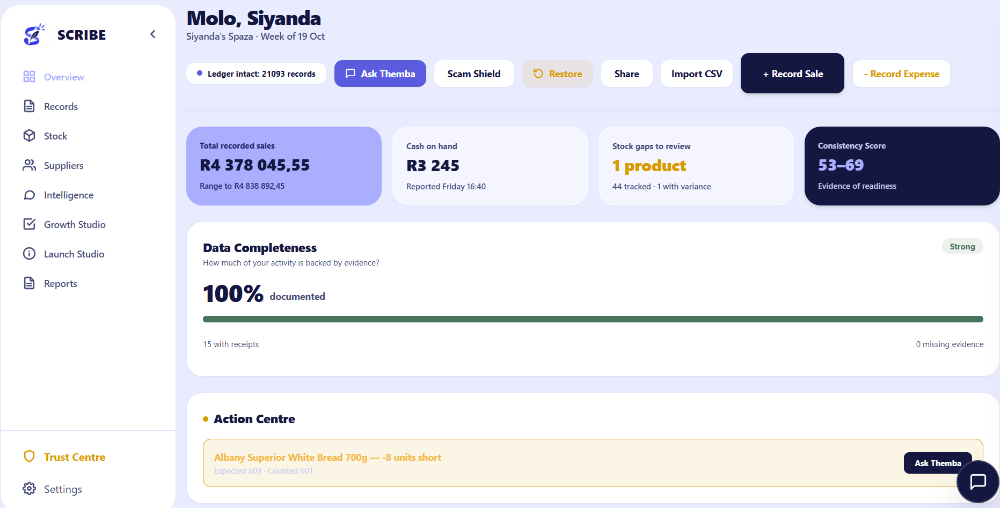<br/><sub><b>Dashboard.</b> Revenue range, Consistency Score, data completeness.</sub></td>
    <td width="50%">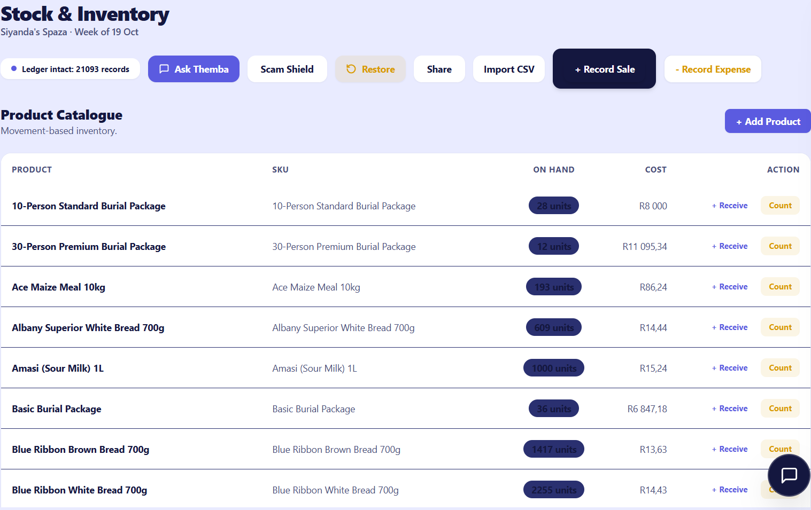<br/><sub><b>Stock reconciliation.</b> Expected versus counted, per product.</sub></td>
  </tr>
  <tr>
    <td width="50%">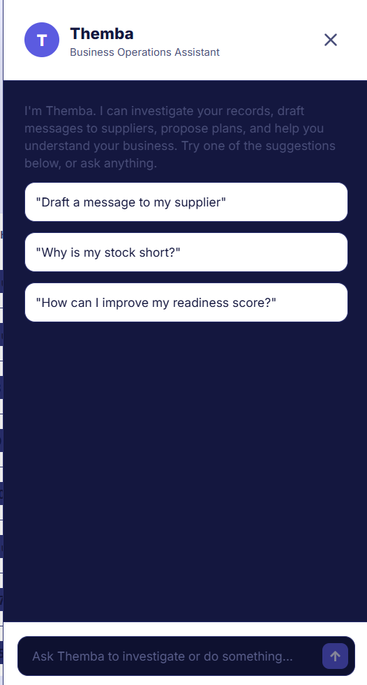<br/><sub><b>Themba.</b> Grounded answers and approval cards.</sub></td>
    <td width="50%">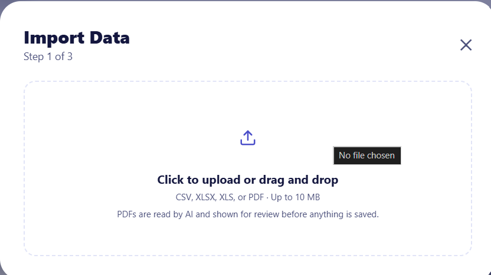<br/><sub><b>Review-first import.</b> Confirm before anything is saved.</sub></td>
  </tr>
  <tr>
    <td width="50%">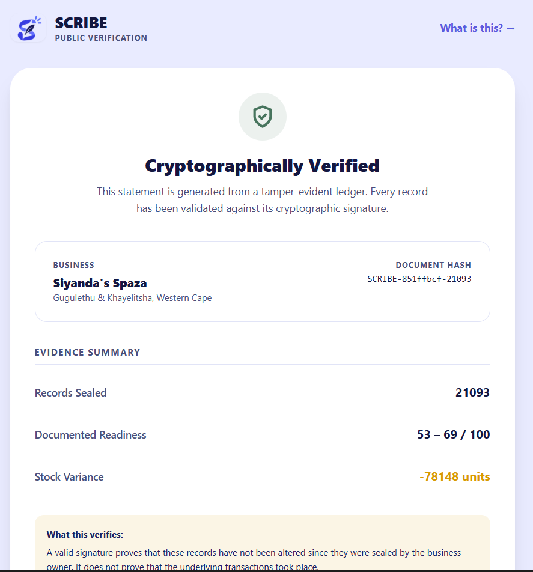<br/><sub><b>Public verification.</b> No login needed for a lender to check integrity.</sub></td>
    <td width="50%">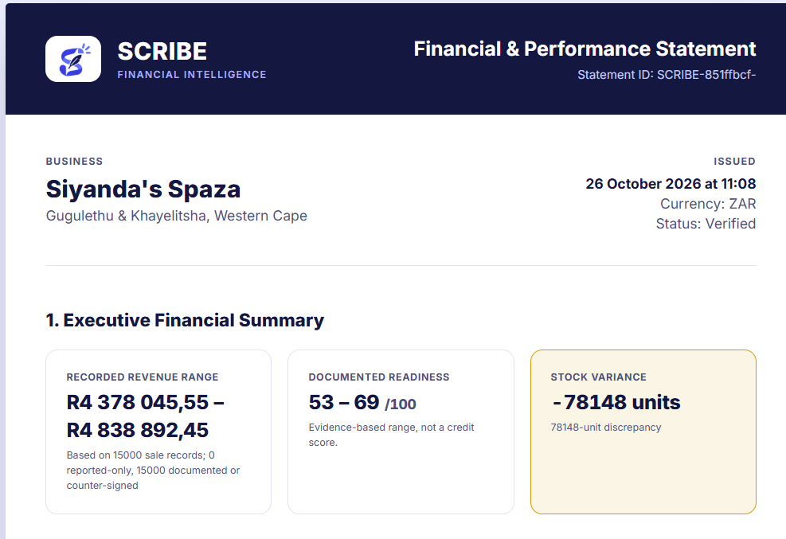<br/><sub><b>Financial statement.</b> Printable, hashed, with QR code.</sub></td>
  </tr>
  <tr>
    <td width="50%">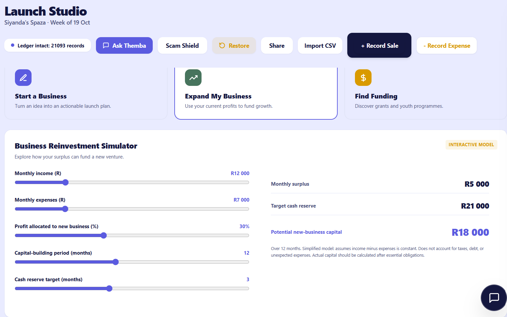<br/><sub><b>Launch Studio.</b> Reinvestment simulator and funding directory.</sub></td>
    <td width="50%">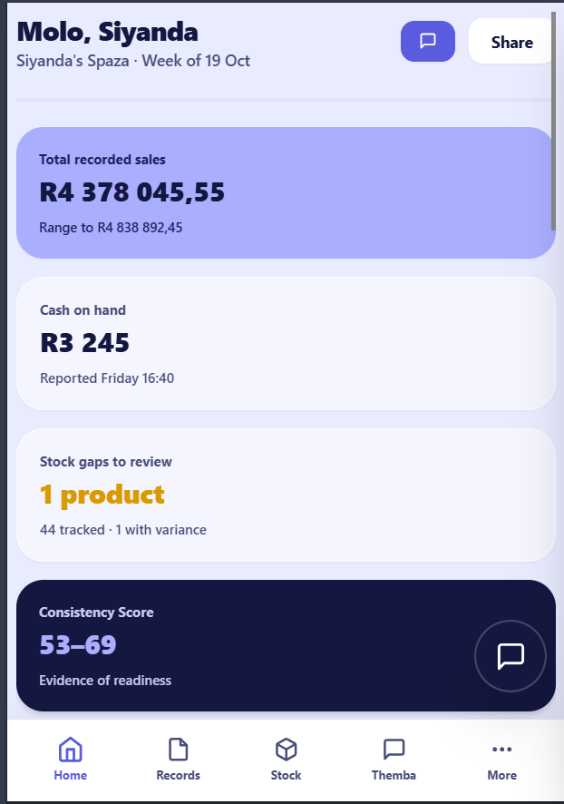<br/><sub><b>Mobile first.</b> Installable PWA with bottom navigation.</sub></td>
  </tr>
</table>

---

## The problem

A small business can trade every day and still struggle to explain how well it is performing.

Sales sit in handwritten notebooks. Supplier purchases exist only as receipts in a drawer. Stock is tracked informally, and cash moves through several hands and several records. The activity is real. What is missing is a way to **reconstruct, reconcile, explain and substantiate** it.

| Context | Figure |
|---|---|
| Official unemployment (Q2 2026) | **33.6%** |
| Youth unemployment | **47.4%** |
| Non-VAT-registered business owners | **1.9 million** |
| Share of employment in the informal sector | roughly **19.5%** |

*Figures are the labour-market statistics the team compiled from Statistics South Africa releases. Check them against the latest release before relying on them elsewhere.*

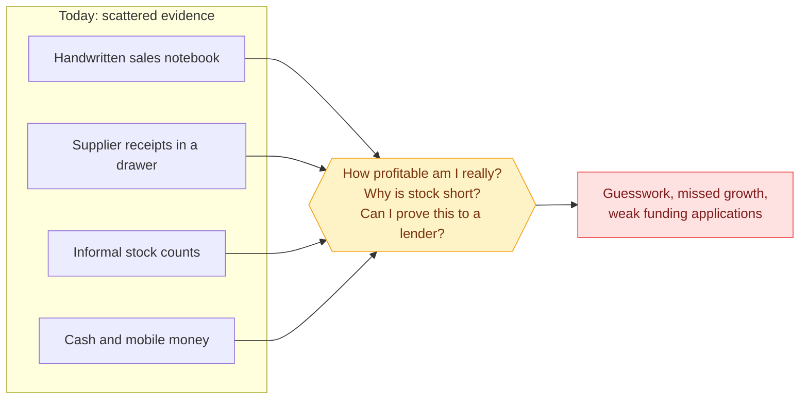

A spaza owner knows roughly what is in the till, but cannot reliably explain the gap between expected and actual stock. They may have strong sales and still lack the documented history that shows a lender, an investor or a support programme what the business can do.

**The gap SCRIBE addresses is the distance between running a business and being able to understand, demonstrate and finance its growth.**

The problem is not that these businesses are unprofitable. It is that their financial activity is hard to reconstruct, explain and prove.

---

## Why this track

We chose **Youth Entrepreneurship and Small-Business Growth** because technology should help existing businesses become more capable of growing, not only help people discover new ideas.

South Africa has people building businesses with limited resources, informal systems and real determination. Many need practical tools to understand their operations, make informed financial decisions and reach opportunities that could help them expand.

Rather than assume every business can adopt expensive accounting software or maintain complex books, SCRIBE starts with **the information a business already has**, structures it, and helps the owner build a clearer picture over time. That matches the challenge of helping young founders and township or rural businesses manage operations, improve funding readiness and reach wider markets.

---

## The solution

<div align="center">
</div>

<br/>

SCRIBE connects the whole journey from an everyday record to an actionable result.

| Step | What happens | Why it matters |
|---|---|---|
| **1. Capture** | The owner photographs a receipt, uploads a CSV, XLSX or PDF, enters a sale by hand, or sends a record through the Telegram channel. | No one has to rebuild their record-keeping before getting value. |
| **2. Extract** | Fields are pulled out of messy sources and structured into transactions. | Turns paper and spreadsheets into data. |
| **3. Review** | The owner sees what was read, corrects uncertain fields and confirms. **Nothing is saved before this step.** | Keeps the human in charge and keeps errors out of the books. |
| **4. Reconcile** | Sales, expenses, purchases and stock movements are compared per product. Variances are flagged. | Shows what the evidence supports and what does not add up. |
| **5. Seal** | Each confirmed record is canonicalised, hashed, chained to the previous record and signed. | Any later change is detectable. |
| **6. Understand** | Revenue ranges, a Consistency Score, completeness tracking and plain-language explanations from Themba. | Turns numbers into decisions. |
| **7. Grow** | Guided tasks, purchase orders, reinvestment scenarios and a funding directory. Exportable, verifiable statements for lenders. | Moves from "what happened" to "what next". |

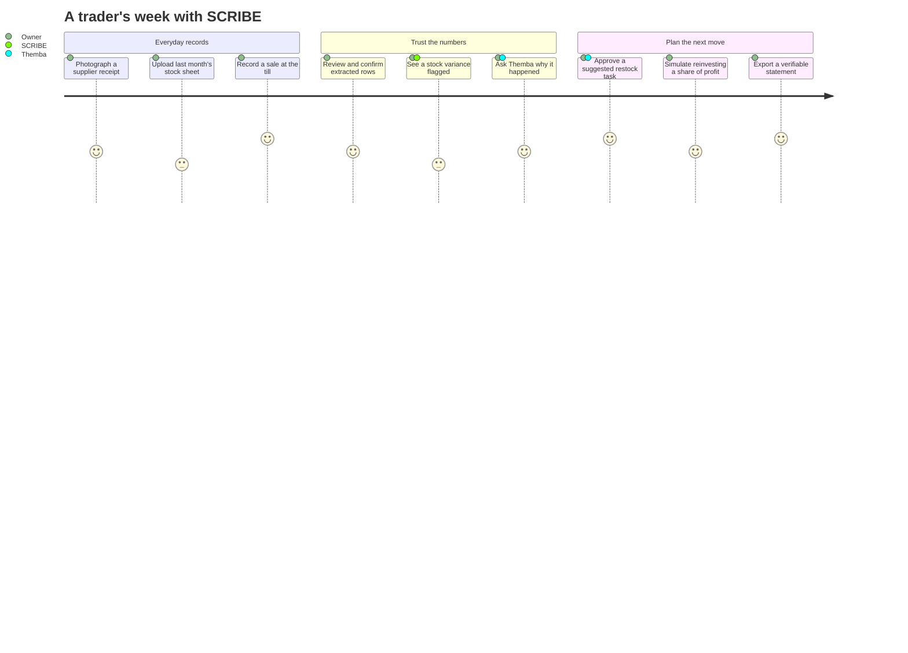

---

## What makes SCRIBE different

SCRIBE is not an OCR demo and not a ledger demo. The differentiator is how the parts work together.

| Differentiator | What it means in practice | Status |
|---|---|---|
| **Reconciliation, not just extraction** | Per-product stock math flags variances instead of simply displaying what was read from a document. | ✅ Working |
| **Traceable, tamper-evident records** | SHA-256 hash chain with Ed25519 signatures and a public verification page. | ✅ Working |
| **Honest uncertainty** | Revenue is a range that reflects evidence quality. The tool says what it cannot confirm. | ✅ Working |
| **Explainable readiness insight** | A 5-component Consistency Score with transparent counterfactuals ("what would change this score"). | ✅ Working |
| **Review-first imports** | CSV, XLSX, PDF and photo imports all stop for confirmation. | ✅ Working |
| **Themba, a grounded copilot** | Context-aware, refuses unsafe requests, proposes actions that need approval. | ✅ Working |
| **Planning and funding preparation** | Start, Expand and Find Funding modes, a reinvestment simulator, a South African funding directory. | ✅ Working |
| **Telegram capture channel** | Send records through a chat app people already use. | 🧪 Prototype |
| **Adaptive record structures** | Business-specific columns and vocabulary, learned per business. | 🧭 Planned (UI mockup built) |
| **WhatsApp Business integration** | The channel most traders actually live in. | 🧭 Planned |
| **Consented bank-feed verification tier** | Corroborate records against bank data with the owner's consent. | 🧭 Planned |

✅ working today · 🧪 prototype or limited · 🧭 planned

---

## What works today

<details open>
<summary><b>🔐 Cryptographic ledger</b></summary>

- Every record is canonicalised, SHA-256 hashed, chained to the previous record and Ed25519-signed.
- Any modification breaks the chain and is detectable on verification.
- A public page at `/verify/[business-id]` lets a lender or auditor confirm integrity without logging in.
- Append-only by design. Corrections are new records, not silent overwrites.

</details>

<details>
<summary><b>🧠 Themba, the AI business assistant</b></summary>

- Multi-provider gateway: Google Gemini first, Groq Llama 3.3 as fallback, then a deterministic fallback if every provider is down.
- Context-aware: tone and content adapt to the tab you are on (Stock, Growth, Settings).
- Grounded: figures come from the deterministic engine, never from the model's imagination.
- Agentic with consent: proposes `create_task` and `draft_message` as cards that need explicit approval.
- Safe: pre-flight refusals for credit decisions, theft accusations and regulated financial advice.

</details>

<details>
<summary><b>📊 Deterministic financial engine</b></summary>

- Per-product stock reconciliation rather than aggregate math.
- Revenue **ranges** that reflect evidence quality.
- 5-component Consistency Score with counterfactuals.
- Data-completeness tracking: how much activity is backed by evidence.
- Pure SVG charts with no third-party chart library.

</details>

<details>
<summary><b>📥 Document intelligence</b></summary>

- CSV import with column mapping (PapaParse).
- XLSX and XLS import (SheetJS).
- PDF extraction through Gemini's native PDF reading.
- Photo scanning with an animated scan beam, corner brackets and a consent gate.
- Review-first workflow on every import.

</details>

<details>
<summary><b>🏢 Business Launch Studio and 📈 Growth Studio</b></summary>

- Three modes: **Start a Business**, **Expand My Business**, **Find Funding**.
- Reinvestment Simulator with live math across income, expenses, allocation and period.
- Real South African funding directory (NYDA, SEDFA, Department of Small Business Development).
- Goals, tasks and milestones, with tasks Themba proposes and the owner approves.

</details>

<details>
<summary><b>📦 Inventory, suppliers, sales and expenses</b></summary>

- Product catalogue with SKU, unit, cost and selling price, and reorder thresholds.
- Movement-based stock ledger. Balances are derived, never overwritten.
- Physical stock counts and a supplier directory.
- Low-stock alerts with a **Draft Purchase Order** workflow.
- Recording a sale deducts stock and updates cash flow. Recording an expense categorises it for the donut chart. The revenue range recalculates immediately.

</details>

<details>
<summary><b>📄 Reports and verification</b></summary>

- CSV transaction ledger export.
- Printable A4 financial statement with its cryptographic hash and a QR code.
- Evidence workspace: a split view of the original receipt next to the extracted data.

</details>

<details>
<summary><b>🎨 Experience</b></summary>

- Three themes: Daylight, Night and Sunlight (high contrast).
- Installable PWA, offline banner with auto-recovery detection.
- Spring-physics animation, skeleton loaders, cursor-tracking spotlight cards.
- Glassmorphic mobile bottom navigation.

</details>

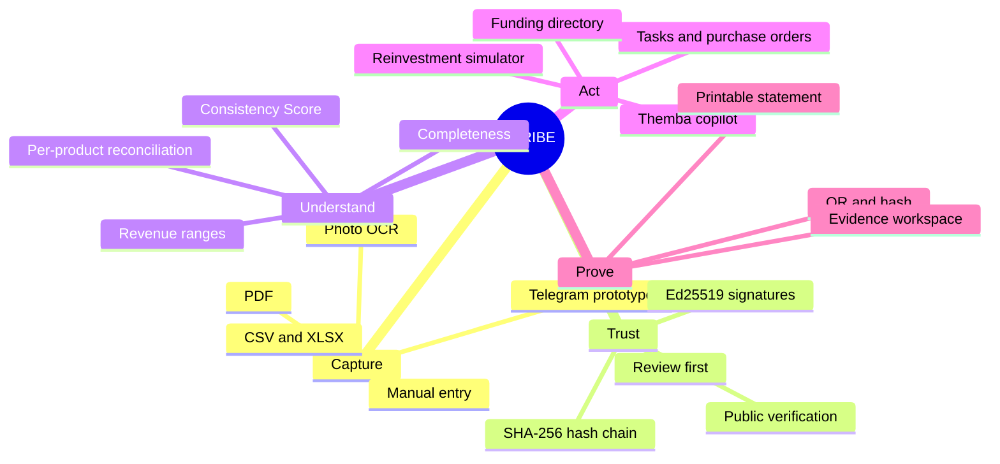

---

## Data integrity: the tamper-evident ledger

<div align="center">
</div>

<br/>

Each record is sealed in five moves:

1. **Canonicalise.** Keys are sorted and JSON is made deterministic, so the same record always produces the same bytes.
2. **Hash.** SHA-256 of the canonical form.
3. **Chain.** The hash of the previous record (`prev_hash`) is part of what gets hashed.
4. **Sign.** The hash is signed with an Ed25519 private key that lives only on the server.
5. **Verify.** Anyone can recompute the hashes, check the signatures and walk the chain.

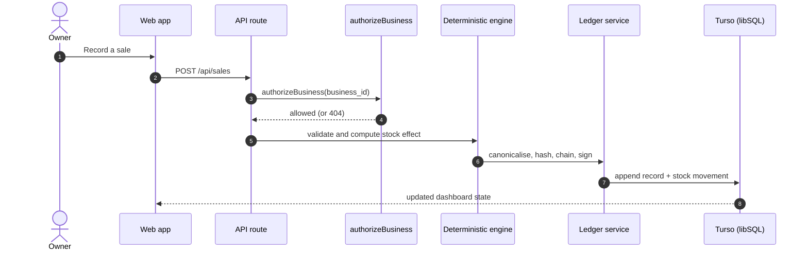

An illustrative, simplified record shape (not the exact production schema):

```json
{
  "id": "rec_000123",
  "business_id": "biz_...",
  "type": "sale",
  "payload": { "product": "Albany Bread", "qty": 2, "amount": 38.0 },
  "prev_hash": "3be7...70a2",
  "hash": "c8d1...5e09",
  "signature": "ed25519:..."
}
```

### What the ledger proves, and what it does not

| It proves | It does **not** prove |
|---|---|
| A record has not been altered since it was sealed. | That the underlying sale actually happened. |
| The order of records has not been rearranged. | That the amounts were entered honestly. |
| The server signed the record. | That a supplier or customer agrees with it. |

That second column is why SCRIBE has **evidence tiers** and a data-completeness measure, and why counter-signing and a consented bank-feed tier are on the roadmap. A tamper-evident record is not automatically a genuine transaction, and SCRIBE says so on its own verification page and statements.

---

## Reconciliation and the financial engine

Stock is reconciled **per product**, because aggregate math hides exactly the discrepancies a shop owner cares about.

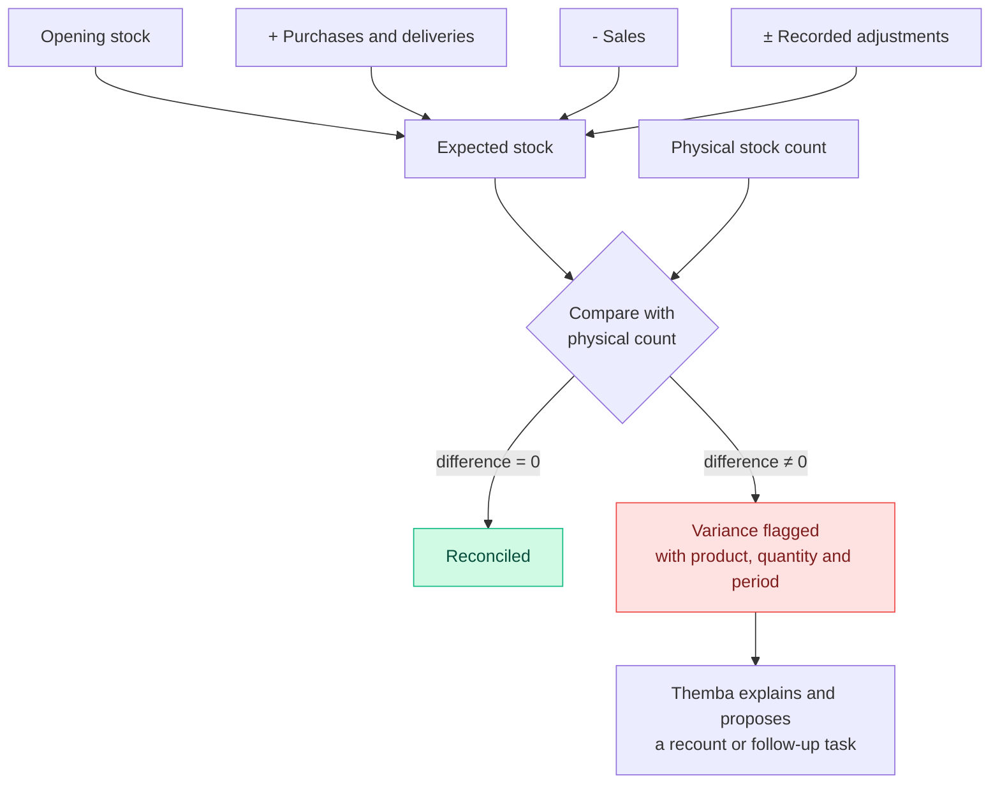

**Worked example from the demo workspace.** One variance was seeded on purpose to demonstrate the flow: *Albany Bread, −8 units.* The reconciliation view shows the expected quantity, the counted quantity and the gap, and Themba can explain it in plain language without accusing anyone of anything.

**Revenue as a range.** When some sales are backed by evidence and some are only claimed, a single revenue number would overstate certainty. SCRIBE shows a range whose width reflects how much of the activity is evidence-backed.

**Consistency Score.** A 5-component score, with transparent counterfactuals that show what would raise or lower it. It is an explainable indicator of how consistent the records are. It is **not** a credit score and has not been validated against lender decisions (see [Testing and validation](#testing-and-validation)).

---

## Themba, the business copilot

Themba helps owners ask better questions about their own business. It is deliberately constrained: **AI reads, code decides, the trader confirms.**

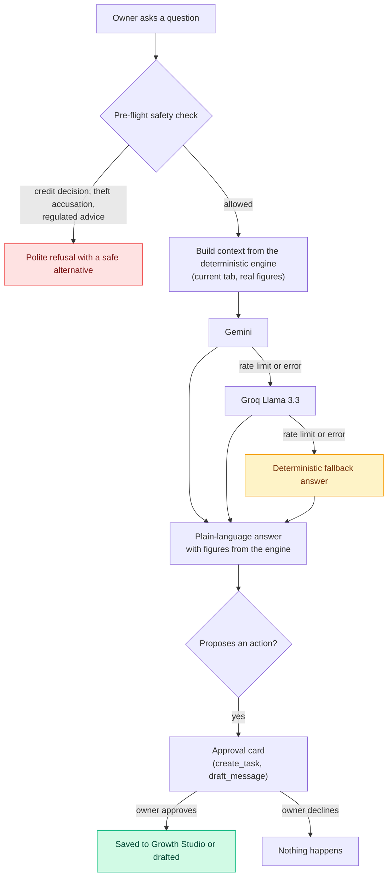

| Principle | How it is enforced |
|---|---|
| **Grounded** | Numbers are injected from the engine. The model explains them, it does not produce them. |
| **Consent before action** | Actions are structured cards. Nothing is written until the owner approves. |
| **Refuses what it should** | Pre-flight checks block credit decisions, theft accusations and regulated financial advice. |
| **Resilient** | If every AI provider fails, a deterministic fallback still answers from the engine. |
| **Context-aware** | Tone and content change with the tab, for example Stock versus Growth. |

---

## Document intelligence

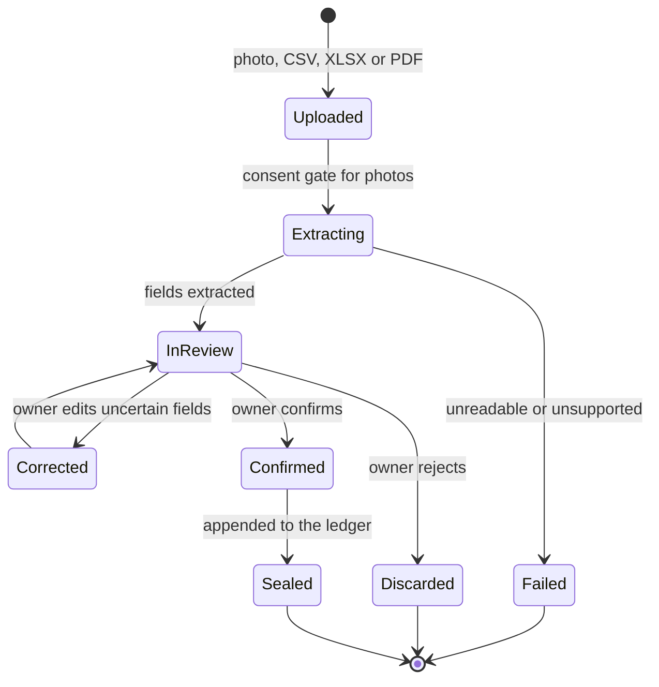

| Source | How it is read | Notes |
|---|---|---|
| CSV | PapaParse with a column-mapping step | Works with the columns a business already has. |
| XLSX / XLS | SheetJS | Sheet and column mapping before import. |
| PDF | Gemini native PDF reading | Output is a draft until confirmed. |
| Photo | Gemini vision with a consent gate | Scan animation, corner brackets, review screen. |
| Manual | Sale and expense forms | Auto-deducts stock and updates cash flow. |

The original document stays linked to what was extracted from it. The evidence workspace shows them side by side so a reviewer, or a lender, can see where a number came from.

---

## Business Launch Studio and Growth Studio

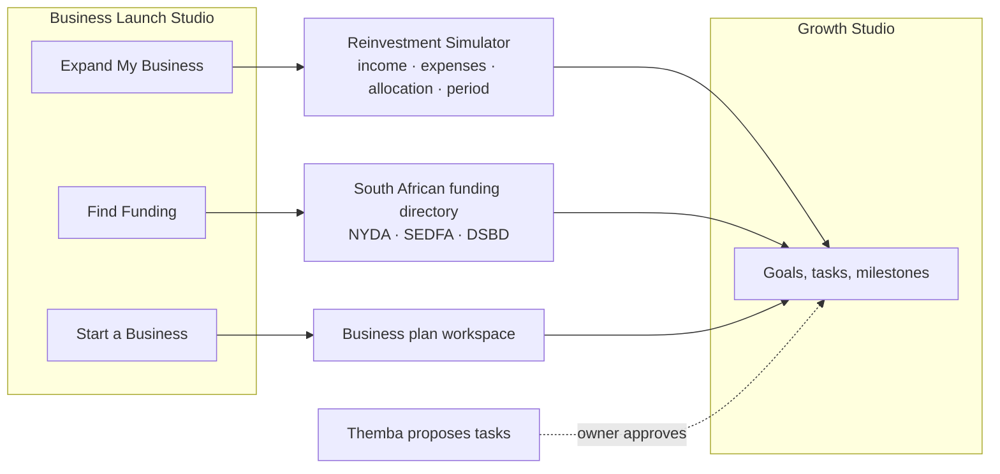

Projections rest on **explicit assumptions and the records the business actually has**. They are scenarios to think with, not guaranteed outcomes, and SCRIBE does not promise that funding will be granted.

---

## Architecture

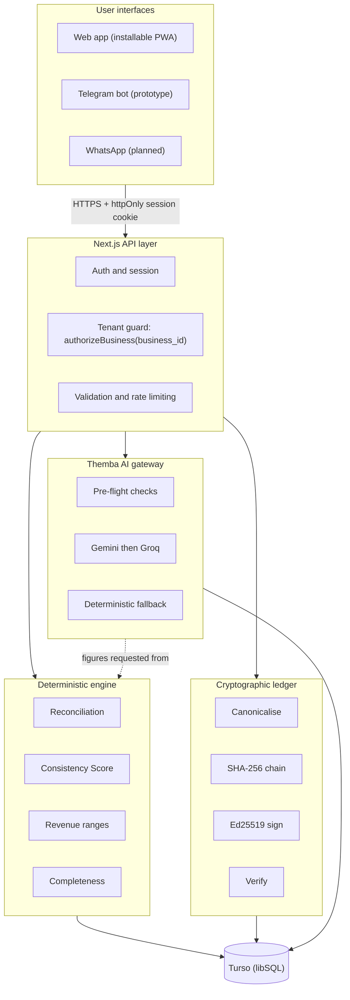

**Principle:** *AI reads, code decides, the trader confirms, the ledger remembers.*

### Request lifecycle

Every request passes the same gates, in the same order:

1. Session cookie checked and the JWT validated.
2. `authorizeBusiness(business_id)` confirms the user belongs to that business. Unauthorised access returns **404**, not 403, so business IDs cannot be enumerated.
3. Input validation and rate limiting.
4. Deterministic engine and ledger logic do the work.
5. Only then does the database change.

### Technology choices

| Layer | Technology | Why |
|---|---|---|
| Framework | Next.js 16 (App Router, Turbopack) | One codebase for UI and API, fast iteration, easy Vercel deploys. |
| Language | TypeScript (strict) | Money, hashes and stock math deserve types. |
| Styling | Tailwind CSS v4 with design tokens | Consistent themes (Daylight, Night, Sunlight) without heavy CSS. |
| Database | Turso (libSQL, serverless SQLite) | Cheap, fast, simple to back up and reason about. |
| Auth | Custom JWT with `jose`, scrypt hashing, httpOnly cookies | Small attack surface, no third-party session store. |
| Cryptography | Node `crypto` (SHA-256, Ed25519) | Standard, audited primitives instead of anything custom. |
| AI | Gemini (primary), Groq Llama 3.3 (fallback) | Resilience and cost control across providers. |
| Parsing | PapaParse, SheetJS, Gemini vision | Cover the formats traders really have. |
| Charts | Pure SVG | No external chart libraries to load or audit. |
| Hosting | Vercel | Automatic deployments from `main`. |

---

## Data model

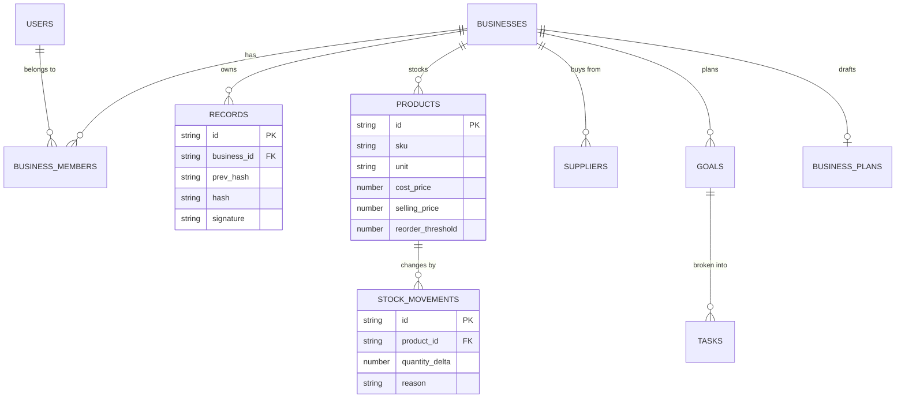

| Table | Purpose |
|---|---|
| `users` | Account identity and hashed passwords |
| `businesses` | Business profile, currency, onboarding status |
| `business_members` | Role-based access (owner, admin, member) |
| `records` | The append-only cryptographic ledger |
| `products` | Catalogue with cost and selling prices |
| `stock_movements` | Append-only inventory ledger. Balances are derived. |
| `suppliers` | Supplier directory |
| `goals`, `tasks` | Growth Studio state |
| `business_plans` | Launch Studio workspace |

The schema lives in `src/lib/schema.sql` and is applied idempotently by `scripts/push-schema.mjs`.

---

## Security and privacy

| Area | Approach |
|---|---|
| **Passwords** | scrypt with a per-user salt. |
| **Sessions** | httpOnly, Secure, SameSite=Lax cookies. JWT expires after 7 days. |
| **Tenant isolation** | Every API route calls `authorizeBusiness(business_id)` before any read or write. Unauthorised access returns 404. |
| **Account safety** | No user enumeration on register or password reset. Reset tokens are hashed at rest, single-use and expire in 30 minutes. |
| **Ledger keys** | The Ed25519 private key is server-side only and never exposed. |
| **Secrets** | Configuration through environment variables. `.env.local` is gitignored. |
| **AI processing** | External AI processing is disclosed to users. Photo scanning is behind a consent gate. |

### POPIA

- A Privacy Policy is published at `/privacy`.
- The demo dataset comes from a real shop whose owner **consented** to anonymised use. Customer names, personal identifiers and sensitive items were anonymised or removed.
- No customer personal information appears in the demo.
- Data deletion is available on request.

---

## Testing and validation

This section is deliberately plain. **If something has not been measured, it says so.**

### Automated checks in the repository

| Script | What it covers |
|---|---|
| `scripts/test-ledger.ts` | Hash chain and signature integrity |
| `scripts/test-reconcile.ts` | Stock reconciliation math |
| `scripts/test-score.ts` | Readiness and Consistency Score computation |

```bash
npx tsx --env-file=.env.local scripts/test-ledger.ts
npx tsx --env-file=.env.local scripts/test-reconcile.ts
npx tsx --env-file=.env.local scripts/test-score.ts
```

### Evidence table

| Measure | What we report | Result |
|---|---|---|
| **Demo dataset** | Real, anonymised spaza records loaded into the live workspace | 21,093 transactions (2021–2026), 44 products, 15,045 stock movements |
| **Reconciliation detection** | Whether a known, seeded discrepancy is surfaced | Seeded Albany Bread −8 variance is flagged. This is a demonstration test, **not** an accuracy benchmark. |
| **Ledger tamper detection** | Whether altering a sealed record is detected | Detected by chain verification (covered by `test-ledger.ts`). Published pass counts: *not yet compiled in this README.* |
| **OCR accuracy** | Field-level accuracy on manually verified sample documents | **Not yet evaluated** |
| **Human correction rate** | How often extracted fields need correcting | **Not yet evaluated** |
| **Handwriting and format coverage** | Performance across handwriting styles and document layouts | **Not yet evaluated** |
| **Business-owner usefulness** | Structured feedback from owners, with permission | **Not yet evaluated.** Early conversations only (see below). |
| **Lender usefulness** | Whether external lenders find the statements and verification page useful | **Not yet evaluated** |
| **Consistency Score validity** | Whether the score tracks real business health | **Not yet validated.** Method is transparent, outcomes are unproven. |

### What we plan to measure next

1. Field-level OCR accuracy on a manually labelled sample of receipts, stock sheets and handwritten notes.
2. Correction rate during review, per field type.
3. Time to first useful insight for a new owner.
4. Structured feedback sessions with consenting owners.
5. A short review of the printable statement and verification page with a lender or support-programme officer.

---

## Development story and real-world engagement

SCRIBE began with one question:

> **What if the information a small business already records every day could become the foundation for its next stage of growth?**

An owner can spend a whole day serving customers, buying stock and recording sales, and still not be able to answer *"How well is my business actually doing, and what would it take to grow?"* We wanted to meet owners where they are, with the records they already keep, rather than ask them to change everything first.

### What has happened, and what has not

| Happened | Not yet happened |
|---|---|
| Discussions and early assessment with **Mr Lungiswa**, a spaza shop owner, about how business information can show performance, growth opportunity and expansion potential. | A completed pilot with measured outcomes. |
| Consent from the owner to use his **anonymised** records (five years of trading data) for the demo workspace. | Structured testing with several businesses. |
| A working application built and tested against that real dataset. | Verified results on OCR accuracy, owner usefulness or lender acceptance. |
| Design decisions shaped by what a real shop's data looks like: informal units, handwritten product names, uneven record-keeping. | Any claim that SCRIBE has improved profit, access to finance or funding approval. |

This engagement is **a starting point, not proof of broad adoption or financial impact.** It informs the product's philosophy: growth should rest on an understanding of current performance, resources, costs, risks and realistic opportunities, not on enthusiasm alone.

### Lessons that shaped the product

- **Real records are messy.** That is why imports are review-first and why revenue is a range.
- **A number without a source is a liability.** That is why every record is sealed and every extraction is linked to its evidence.
- **Owners need explanations, not dashboards.** That is why Themba exists, and why it is grounded in the engine.
- **Trust comes from admitting limits.** That is why this README has a limitations section.

---

## Impact, limitations and responsible AI

### Intended impact

*These are intended outcomes that still require validation. SCRIBE does not guarantee access to finance, business success or funding approval.*

| For | Intended benefit |
|---|---|
| **Business owners** | Clearer visibility into sales, costs and stock. Faster spotting of missing or unexplained transactions. Less manual organising. Better decisions on purchasing, pricing and reinvestment. |
| **Aspiring entrepreneurs** | Structured planning, startup cost estimates, discovery of funding and mentorship, clearer budgets and supporting documents. |
| **The wider ecosystem** | Better record-keeping habits, more organised financial histories, and easier preparation of information for lenders and support organisations. |

### What SCRIBE does not do

- Verify that a sale was real. It shows only that a record has not been altered since sealing.
- Replace a credit score.
- Guarantee loan approval or repayment.
- Give regulated financial advice on loans, investments or tax.
- Guarantee higher profit.
- Independently authenticate every transaction.
- Integrate directly with point-of-sale systems (roadmap).

### Known limitations

- AI providers sometimes hit rate limits. The fallback chain engages automatically, but answers may be simpler.
- The import wizard does not yet detect duplicates through idempotency keys.
- Forecasts beyond 14 days use simplified assumptions.
- OCR quality across handwriting styles and layouts has not been measured.
- The Consistency Score is explainable but unvalidated against outcomes.
- Multi-language support (isiXhosa, isiZulu, Afrikaans) has infrastructure in place, but translations are awaiting native-speaker review.

### Responsible AI principles

1. **Make assumptions visible.** Ranges, counterfactuals and completeness measures exist so uncertainty is shown, not hidden.
2. **Keep humans in control.** Review-first imports and approval cards mean nothing important happens silently.
3. **Ground every figure.** The model explains numbers computed by code.
4. **Refuse what it should refuse.** No credit decisions, no accusations, no regulated advice.
5. **Fail safely.** If AI is unavailable, deterministic answers still work.
6. **Respect people's data.** Consent, anonymisation, disclosure of external processing, deletion on request.

---

## Roadmap

```mermaid
flowchart LR
    subgraph NOW["Now: working MVP"]
        N1["Hash-chained, signed ledger"]
        N2["Per-product reconciliation"]
        N3["Themba copilot"]
        N4["Review-first imports"]
        N5["Launch and Growth Studios"]
    end
    subgraph NEXT["Next: validate and harden"]
        X1["OCR accuracy study"]
        X2["Duplicate detection on import"]
        X3["Owner feedback sessions"]
        X4["Native-reviewed isiXhosa, isiZulu, Afrikaans"]
        X5["Full PDF invoice export"]
    end
    subgraph LATER["Later: reach and trust"]
        L1["WhatsApp Business integration"]
        L2["Consented bank-feed verification tier"]
        L3["Supplier and customer counter-signing"]
        L4["Adaptive OCR with per-business vocabulary"]
        L5["Custom ledger column builder"]
        L6["POS integrations"]
    end
    NOW --> NEXT --> LATER
```

---

## Setup and environment

### Prerequisites

- **Node.js 20+**
- **Git**
- A **Turso** account or the Turso CLI

### Install

```bash
git clone https://github.com/vna-07/scribe-app.git
cd scribe-app
npm install
cp .env.example .env.local
# fill in your secrets (see below)
```

### Database

```bash
# apply the schema to Turso (idempotent)
node --env-file=.env.local scripts/push-schema.mjs
```

### Run

```bash
npm run dev
```

Open [http://localhost:3000](http://localhost:3000).

### Environment variables

Create `.env.local` in the project root:

```bash
# ─── DATABASE ───
TURSO_URL=libsql://your-database.turso.io
TURSO_TOKEN=your-turso-token

# ─── AUTH ───
JWT_SECRET=<64-hex-chars>            # openssl rand -hex 32

# ─── CRYPTOGRAPHY ───
ED25519_PRIVATE_KEY_B64=<base64-pem>
ED25519_PUBLIC_KEY_B64=<base64-pem>
# generate a key pair: node scripts/gen-keys.mjs

# ─── AI PROVIDERS ───
GEMINI_API_KEY=<your-gemini-key>
GROQ_API_KEY=<your-groq-key>         # optional fallback

# ─── DEPLOYMENT ───
NEXT_PUBLIC_APP_URL=https://scribe-app-xi.vercel.app
```

> ⚠️ Never commit `.env.local`. It is gitignored. Treat the Ed25519 private key and `JWT_SECRET` like passwords.

### Scripts

| Script | Purpose |
|---|---|
| `scripts/push-schema.mjs` | Idempotently applies the schema to Turso |
| `scripts/gen-keys.mjs` | Generates an Ed25519 key pair |
| `scripts/test-ledger.ts` | Tests hash chain and signature integrity |
| `scripts/test-reconcile.ts` | Tests stock reconciliation math |
| `scripts/test-score.ts` | Tests readiness scoring |

### Deployment

Deployed on Vercel with automatic deployments from the `main` branch.

```bash
vercel --prod
```

Production checklist:

- ✅ All environment variables set in the Vercel dashboard
- ✅ Turso database configured with the schema
- ✅ Ed25519 keys generated and stored securely
- ✅ Domain: `scribe-app-xi.vercel.app`

---

## API reference

All routes require a valid session cookie except `/api/auth/*`.

| Method | Route | Purpose |
|---|---|---|
| POST | `/api/auth/register` | Create an account |
| POST | `/api/auth/login` | Log in |
| POST | `/api/auth/logout` | Log out |
| POST | `/api/auth/password-reset/request` | Request a reset token |
| POST | `/api/auth/password-reset/confirm` | Confirm a reset |
| GET, POST | `/api/businesses` | List or create businesses |
| GET | `/api/demo/[id]` | Load full dashboard data |
| POST | `/api/records` | Seal a new ledger record |
| POST | `/api/sales` | Record a sale (deducts stock) |
| POST | `/api/expenses` | Record an expense |
| GET, POST | `/api/stock` | Products, movements, counts |
| GET, POST | `/api/suppliers` | Supplier directory |
| GET, POST | `/api/goals` | Goals, tasks, progress |
| POST | `/api/import` | CSV and XLSX import |
| POST | `/api/import/pdf` | PDF extraction |
| POST | `/api/ocr` | Image OCR for receipts |
| POST | `/api/themba` | AI assistant gateway |
| POST | `/api/scam-shield` | Rule-based scam detection |
| GET | `/api/ledger/verify` | Chain integrity check |

---

## FAQ for reviewers

<details>
<summary><b>Is the data real?</b></summary>

<br/>

Yes. The demo workspace runs on real transaction records from a Western Cape spaza shop, anonymised with the owner's consent. Customer names, personal identifiers and sensitive items were removed. One variance was seeded deliberately to demonstrate reconciliation.

</details>

<details>
<summary><b>Does the cryptography prove a sale really happened?</b></summary>

<br/>

No, and the product says so. It proves a record has not been altered since sealing. Proving that a sale was genuine needs corroboration, which is why evidence tiers exist and why counter-signing and bank-feed verification are on the roadmap.

</details>

<details>
<summary><b>Can Themba make things up?</b></summary>

<br/>

Figures come from the deterministic engine, not the model. If every AI provider is down, a deterministic fallback still answers. Themba also refuses credit decisions, theft accusations and regulated financial advice, and any action it proposes needs the owner's approval.

</details>

<details>
<summary><b>Is this a credit score or a lending decision tool?</b></summary>

<br/>

No. The Consistency Score is an explainable indicator of how consistent the records are. It is not a credit score, it has not been validated against lender outcomes, and SCRIBE does not guarantee any funding result.

</details>

<details>
<summary><b>What is finished and what is not?</b></summary>

<br/>

See [What makes SCRIBE different](#what-makes-scribe-different) for status flags, [Testing and validation](#testing-and-validation) for what has and has not been measured, and [Roadmap](#roadmap) for what comes next.

</details>

<details>
<summary><b>How is one business's data kept from another's?</b></summary>

<br/>

Every API route calls `authorizeBusiness(business_id)` before reading or writing. Unauthorised requests get a 404 rather than a 403 so business IDs cannot be probed.

</details>

---

## Team and contact

**Code Blooded** · FNB App of the Year Hackathon 2026

| Person | Role |
|---|---|
| **Ayolela Vena** | Product and AI lead |
| **Lindokuhle Klaas** | Field research and impact |
| **Leopa** | Technical lead (security, cryptography, infrastructure) |

**Contact:** [avianrossi@gmail.com](mailto:avianrossi@gmail.com)
**Live app:** [scribe-app-xi.vercel.app](https://scribe-app-xi.vercel.app) · **Source:** [github.com/vna-07/scribe-app](https://github.com/vna-07/scribe-app)

Feedback from small-business owners, entrepreneurs, developers, lenders and potential partners is very welcome as we keep testing the product against real needs.

### Acknowledgements

With thanks to **Mr Lungiswa**, who trusted us with five years of real business records so SCRIBE could be built against the realities of a working spaza shop, and for the early conversations about performance and expansion that shaped this project.

### Glossary

| Term | Meaning |
|---|---|
| **Spaza shop** | A small informal convenience store, common in South African townships. |
| **Reconciliation** | Comparing expected stock and cash against what was actually counted or received. |
| **Hash chain** | Records linked so that each one contains the hash of the one before it. |
| **Ed25519** | A modern digital signature scheme. |
| **Tamper-evident** | Changes cannot be made without being detectable. Not the same as tamper-proof. |
| **POPIA** | South Africa's Protection of Personal Information Act. |
| **NYDA / SEDFA / DSBD** | National Youth Development Agency, Small Enterprise Development and Finance Agency, Department of Small Business Development. |

### License

Built for educational and demonstration purposes as part of the FNB App of the Year Hackathon 2026. Not for commercial use without permission.

<div align="center">

<br/>

**SCRIBE Intelligence**
*Real Records. Greater Opportunities.*

**Better records. Clearer decisions. More informed growth.**

</div>
